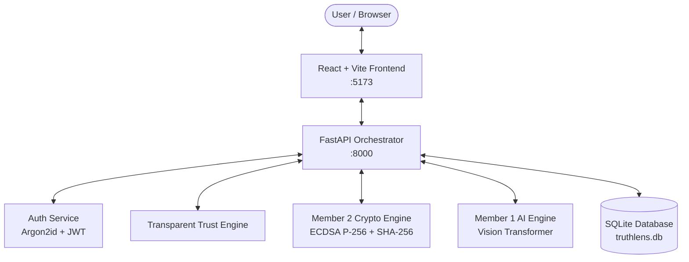

# TruthLens: AI-Powered Digital Media Authenticity & Provenance Verification

**Course Project:** AI 331  
**Team Architecture:** 3-Member Collaborative Project  
- **Member 1:** AI / ViT Deepfake Detection Service  
- **Member 2:** Cryptographic Integrity & ECDSA Signing Engine  
- **Member 3 (This Work):** Full-Stack Architecture, FastAPI Orchestration Backend, React Dashboard Frontend, Transparent Rule-Based Trust Assessment Engine, RBAC Security, and Integration  

---

## 🌟 Overview

TruthLens addresses the digital misinformation crisis by combining **AI-driven media forgery detection** with **cryptographic provenance verification**. Instead of relying on a black-box AI score alone, TruthLens implements a multi-layer verification pipeline:

1. **Cryptographic Integrity (SHA-256):** Verifies bitwise image integrity against registered provenance records.
2. **Cryptographic Provenance (ECDSA P-256):** Validates digital signatures issued by verified news publishers or cameras.
3. **AI Authenticity Analysis (ViT):** Assesses whether the visual artifacts match synthetic/generative AI generation.
4. **Transparent Trust Engine:** Combines cryptographic truth and AI heuristics using a deterministic 6-verdict policy.

---

## 🚀 Live Demo & Quick Start

Both the backend and frontend are ready and configured to run locally.

### 1. Backend (FastAPI)
```powershell
# In project root (d:\TruthLens-main)
$env:PYTHONPATH = "d:\TruthLens-main"
python -m uvicorn backend.app.main:app --host 127.0.0.1 --port 8000 --reload
```
* Interactive API Documentation (Swagger): [http://127.0.0.1:8000/docs](http://127.0.0.1:8000/docs)
* Health Status: [http://127.0.0.1:8000/api/health](http://127.0.0.1:8000/api/health)

### 2. Frontend (React + Vite + Tailwind CSS)
```powershell
cd d:\TruthLens-main\frontend
npm run dev
```
* Web Dashboard: [http://127.0.0.1:5173](http://127.0.0.1:5173)

---

## 🔐 Default Seeded Accounts

The application automatically seeds 3 role-based test accounts upon initial startup:

| Role | Email | Password | Permissions |
|------|-------|----------|-------------|
| **Admin** | `admin@truthlens.local` | `AdminPass123!` | System health, full audit log inspection, user role management |
| **Publisher** | `publisher@truthlens.local` | `PublisherPass123!` | Asset registration, cryptographic signing, registry inspection |
| **User** | `user@truthlens.local` | `UserPass123!` | Media verification, report viewing, history inspection |

---

## 🧩 Architecture



### Trust Assessment Engine Policy (6 Deterministic States)
- `VERIFIED_TRUSTED`: Provenance matched, signature valid, AI detects real media.
- `INTEGRITY_MISMATCH`: Provenance record exists for asset ID, but SHA-256 hash has changed (tampered media).
- `INVALID_SIGNATURE`: Cryptographic signature fails mathematical verification with publisher's public key.
- `SUSPICIOUS_AI`: No registered provenance, AI model flags high likelihood of synthetic generation.
- `VERIFIED_TRUSTED_WITH_AI_CONFLICT`: Valid cryptographic proof from verified publisher, but AI flags synthetic markers (e.g. AI-assisted official graphics).
- `INCONCLUSIVE`: Unregistered media without definitive cryptographic or AI signals.

---

## 🧪 Automated Test Suite

Run all verification and full-stack integration tests:
```powershell
$env:PYTHONPATH = "d:\TruthLens-main"
python -m pytest backend/tests -v
```

All 11 integration tests pass:
- ✅ Health endpoints & system status
- ✅ User authentication & Argon2id hashing
- ✅ Role-based access control (RBAC) enforcement
- ✅ Media registration & ECDSA signature creation
- ✅ Media verification & SHA-256 integrity checks
- ✅ Tampered image detection (Integrity Mismatch)
- ✅ Dashboard metric aggregation

